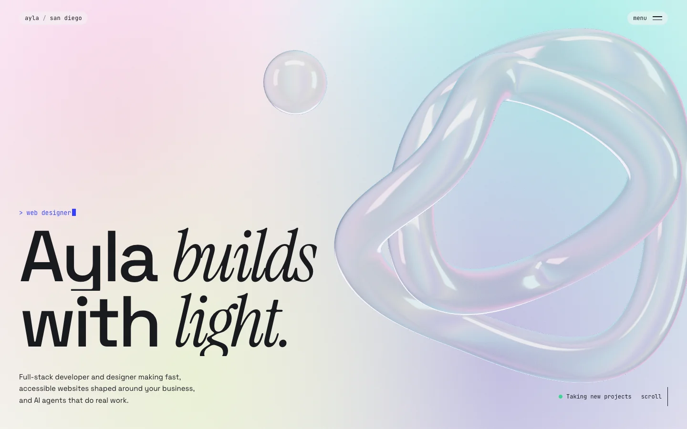
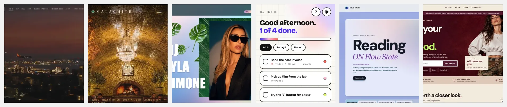

<div align="center">

# Ayla Basha · Developer Portfolio

**Full-stack developer and designer. Client websites, mobile and web apps, and agentic AI.**

[Live site](#deploy) · [Case studies](#projects) · [GitHub](https://github.com/spacegray) · [LinkedIn](https://www.linkedin.com/in/aylabasha/)


</div>



## Overview

A client-first portfolio. A visitor picks what they are building (real estate, an artist site, a restaurant, a shop or app, or AI for their business), and the section re-themes itself to show what that kind of client needs and the live project that delivers it. Every project has a case study covering the problem, what it had to do, constraints, page and data flow, screens and approach.

The site is static, has no UI framework runtime, and loads its WebGL hero only after first paint.

## Projects



| Project | Type | Built with | Links |
|---|---|---|---|
| **Lanna Parker, JD** | Live client site. Designed and maintained. | Property search, building directory, local SEO | [Live](https://downtownlannabrown.com/) |
| **Malachite** | Restaurant and lounge concept | Astro, TypeScript, Tailwind CSS, SVG | [Live](https://malachite-demo-sigma.vercel.app/) · [Code](https://github.com/spacegray/-Malachite-Restaurant) |
| **DJ Ayla Simone** | Live artist site | Music player, events, merch shop | [Live](https://www.djaylasimone.com/) |
| **Daypad** | iOS, Android and web app | React Native, Expo, Zustand, Reanimated | [Live](https://daypad.vercel.app/) · [Code](https://github.com/spacegray/RN-To-Do-List) |
| **Neurotype Reader** | Web app | React 19, Vite, Cloudflare Workers, D1, Drizzle | [Live](https://neurotype-reader.urbansafariwear.chatgpt.site/) · [Code](https://github.com/spacegray/Neuro-Reader) |
| **Goodfind** | Product in progress | Python, JavaScript, SQLite | [Code](https://github.com/spacegray/Goodfind) |

## Skills shown in this codebase

| Skill | Where to look |
|---|---|
| Real-time 3D on the web | [`hero-glass.ts`](src/scripts/hero-glass.ts): physically based glass with transmission, iridescence and dispersion, a generated environment map, and a render loop that pauses off screen. |
| Accessible interaction patterns | [`Selector.astro`](src/components/Selector.astro): ARIA tabs with arrow, Home and End keys. [`Nav.astro`](src/components/Nav.astro): a focus-trapped menu that closes on Esc. [`Work.astro`](src/components/Work.astro): a filter that uses `aria-pressed` and announces its result count. |
| Content modeling | [`src/data/`](src/data): projects, industries, experience and skills are typed data, and cards, case-study pages and the sitemap are generated from them. |
| Theming with design tokens | [`global.css`](src/styles/global.css): Tailwind 4 `@theme` tokens, plus `[data-theme]` variables that re-skin a section per industry. |
| Scroll-driven motion | [`Intro.astro`](src/components/Intro.astro): a word-by-word GSAP ScrollTrigger scrub. [`reveal.ts`](src/scripts/reveal.ts): reveals use one IntersectionObserver with staggered delays. |
| Performance | Static output, responsive WebP from `astro:assets`, and three.js lazy-loaded only when WebGL2 is available. Phones and reduced-motion users get a single still frame. |
| SEO | Per-page titles and descriptions, Open Graph and Twitter cards, a canonical URL, `Person` JSON-LD, and a sitemap. |
| Progressive enhancement | The contact form validates inline and posts to a form service when `PUBLIC_FORM_ENDPOINT` is set. Otherwise it opens the visitor's email app with the message filled in. |

## Style and design choices

**Direction: "builds with light."** Liquid metal, glass and holographic foil on a soft, airy ground. The aim is a site that feels crafted, not templated, while the content stays calm and easy to scan.

- **Liquid-glass hero.** The hero is a closed ribbon and a bubble rendered with three.js `MeshPhysicalMaterial`, using transmission, iridescence and dispersion. The material reflects a rainbow studio environment built at runtime, so the glass picks up color without any image downloads. It tilts toward the pointer and untwists as you scroll. A CSS foil gradient is the fallback.
- **Pantone-style chips.** Each project card is styled like a color chip, with a name (GOLD SATIN, MALACHITE, LIME TAPE) and a code. The swatch takes its colors from the project's own brand, so the grid previews each project's palette before you open it.
- **Texture, then restraint.** Grain, foil and an oxblood crystal-glass texture add depth behind sections. The text above them stays plain: high contrast, short lines and generous space.
- **Type pairing.** Space Grotesk for headlines and interface. Instrument Serif italic for the one soft word in a headline ("builds", "light", "work"). JetBrains Mono for labels, codes and section numbers.
- **Color tokens.**

  | Token | Hex | Use |
  |---|---|---|
  | Mist | `#F2F2F2` | Page ground |
  | Ink | `#17181D` | Text |
  | Candied | `#F7CDE7` | Highlights, underlines |
  | Opal | `#9FF0E6` | Foil and glass tint |
  | Lilac | `#BEB9DE` | Foil and glass tint |
  | Sage | `#E8EFD2` | Soft panels |
  | Blue | `#2E3BFF` | Links, accents |
  | Tangerine | `#FF6B1A` | Agentic AI section |
  | Gold | `#C9A55B` | Real estate and restaurant themes |

- **A theme for each industry.** The "What are you building?" selector crossfades the whole section into the client's world: gold satin for real estate, crystal noir for artists, malachite and gold for restaurants, plum and lime for shops, and electric blue with tangerine for AI. Visitors see their kind of site before they read about it.
- **Motion with a purpose.** Headlines rise in, sections reveal once, and the intro text fills word by word as you scroll. There are no scroll hijacks or parallax gimmicks. Everything turns off under `prefers-reduced-motion`.
- **Client-first copy.** Each section answers a client question (what do you need, what does it look like, how do we work), and the case studies state design decisions rather than claimed results.

## Accessibility and performance

- Semantic landmarks, a skip link, one `h1` per page and an ordered heading outline
- Keyboard support for the menu, the selector tabs, the work filter and the contact form
- Tap targets of 44 px on mobile
- Alt text on every image, and links that open a new tab say so to screen readers
- Respects `prefers-reduced-motion`
- Checked for horizontal scroll at 375 px and 1440 px
- The WebGL hero loads after first paint, pauses when off screen or in a hidden tab, and is skipped on devices without WebGL2

## Project structure

```text
src/
  components/      Hero, Nav, Intro, Selector, Work, ProjectCard, AgenticAI, Process, Experience, Contact, Footer
  data/            site.ts, projects.ts, industries.ts, experience.ts (all content lives here)
  layouts/         Base.astro (SEO, fonts, JSON-LD, nav and footer)
  pages/           index, work/[slug] (generated case studies), 404
  scripts/         hero-glass.ts (three.js), reveal.ts
  styles/          global.css (tokens, themes, textures)
  assets/          project screenshots and textures, optimized at build
```

To add a project: put screenshots in `src/assets/projects/` and add an entry to `projects` in `src/data/projects.ts`. Its card, filter category, case-study page and sitemap entry are generated.

## Run locally

Requires Node 22 or later.

```bash
npm install
```

```bash
npm run dev
```

```bash
npm run build
```

## Deploy

The build is a static `dist/` folder, deployed on Vercel. On Vercel, canonical URLs and the sitemap use the project's production URL automatically. For a custom domain, set `SITE_URL` (for example `https://aylabasha.com`) in the project's environment variables. To have the contact form post to a form service, set `PUBLIC_FORM_ENDPOINT`.

```bash
npx vercel --prod
```

---

Designed and built by Ayla Basha, San Diego.
